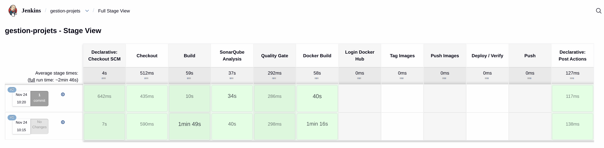
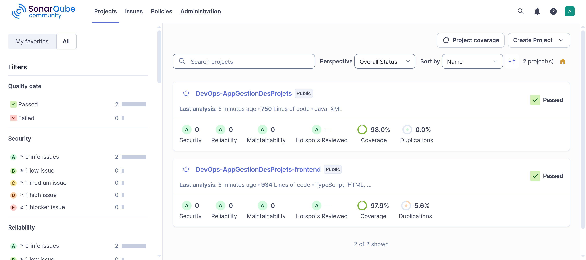
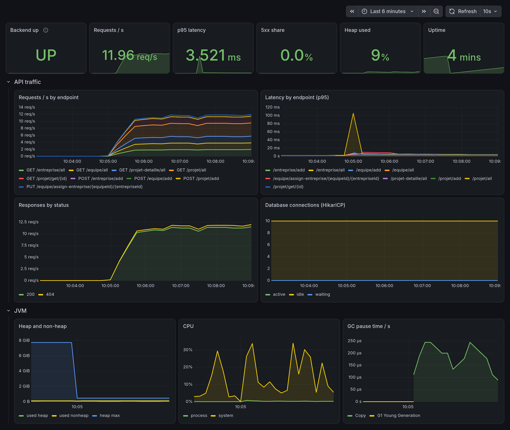
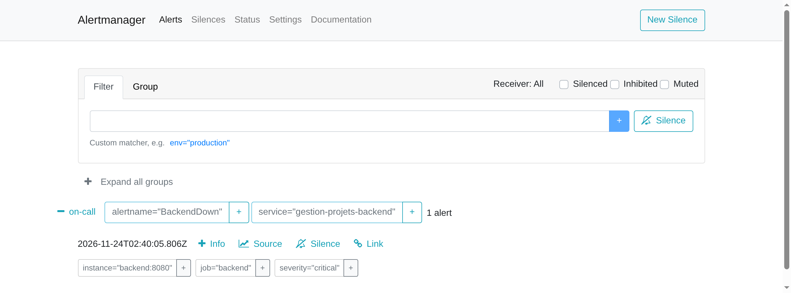
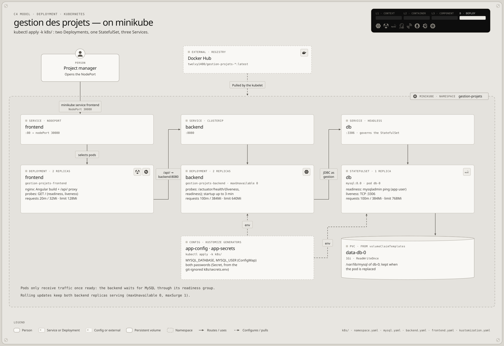

<h1 align="center">Gestion des projets · DevOps</h1>

<p align="center">
  A small Spring Boot + Angular CRUD app taken through a full delivery path: a <b>10-stage Jenkins pipeline</b> that tests,<br>
  analyses and gates both halves in SonarQube before any image is built, Docker Hub images, Prometheus, Grafana and Alertmanager<br>
  on the running backend, and Kubernetes manifests verified on minikube.
</p>

<p align="center">
  
  
  
  
  
  
  
  <a href="https://hub.docker.com/u/twelvy1400"></a>
</p>

<p align="center">
  
  <br><sub>This Jenkinsfile on this branch, run with <code>PUBLISH=false</code>: tests, both analyses, both quality gates and the image build pass; the five publish stages are skipped (build #2: 1 min 30 s on warm caches).</sub>
</p>

---

## What it is for

This repository is my fork of a course project. The application itself, four related CRUD screens for companies, teams, projects and project details, is the course's starter (the first commit). Everything around it is mine, built to practise the delivery side end to end:

- **No image is built from unchecked code.** Jenkins compiles both halves, runs 28 backend and 20 frontend tests with coverage, sends both analyses to SonarQube and stops if either quality gate is red. Only then are images built.
- **The quality bar is real, not decorative.** Both projects show 0 bugs, 0 vulnerabilities, 0 code smells and 0 open security hotspots, with A ratings throughout. Reaching that meant fixing what the scanner found (see [Quality](#quality)).
- **A branch can be checked before merge.** `BRANCH` selects what to build; `PUBLISH=false` runs the pipeline as CI only, with no Docker Hub push, no redeploy and no git tag.
- **The running backend is observable.** Prometheus scrapes Micrometer metrics, Grafana opens on a provisioned dashboard, and four alert rules route through Alertmanager by severity.
- **It runs on Kubernetes as well as Compose.** Two Deployments, a MySQL StatefulSet, probes wired to Actuator health groups, and secrets kept out of git.

## How it works

<picture>
  <source media="(prefers-color-scheme: dark)" srcset="docs/diagrams/c4/c4-container-dark.svg">
  
</picture>
<p align="center"><sub>C4 level 2 · <a href="docs/diagrams/c4/c4-context-light.svg">level 1: context</a> · <a href="docs/diagrams/c4/c4-component-light.svg">level 3: inside the backend</a> · <a href="docs/diagrams/c4/c4-deployment-light.svg">deployment on Kubernetes</a></sub></p>

- **One origin for the browser.** nginx serves the Angular build and proxies `/api/` to `backend:8080` (the dev server does the same through `proxy.conf.json`). The API therefore needs no CORS, and it sends none.
- **Health has two meanings.** Liveness asks only whether the JVM answers. Readiness also includes MySQL, so a pod that loses its database stops receiving traffic instead of being restarted in a loop.
- **Request bodies are not entities.** Controllers bind JSON to small request records and copy only writable fields onto the stored record. A client cannot pick an id on create, and editing a team keeps its project assignments.

### The pipeline

| # | Stage | What it does |
|---|---|---|
| 1 | Checkout | `git` on `BRANCH` (default `main`) with the GitHub credential |
| 2 | Build | `./mvnw clean package`, `npm ci && npm run build` |
| 3 | SonarQube Analysis | backend `./mvnw verify sonar:sonar` (JUnit + JaCoCo); frontend `npm run test:ci` (Vitest + lcov) then `sonar-scanner-cli` |
| 4 | Quality Gate | [`scripts/quality-gate.sh`](scripts/quality-gate.sh) polls both gates; any red gate fails the build |
| 5 | Docker Build | `twelvy1400/gestion-projets-{backend,frontend}:build-N` |
| 6–8 | Login, Tag, Push | `:build-N` and `:latest` to Docker Hub, then pulled back as proof *(skipped when `PUBLISH=false`)* |
| 9 | Deploy / Verify | `docker compose up -d --build`, then [`scripts/deploy-verify.sh`](scripts/deploy-verify.sh) checks DB, API, SPA, SonarQube and the `/api` proxy *(skipped when `PUBLISH=false`)* |
| 10 | Push | tags the commit `build-N` and pushes tags only, so the pipeline never retriggers itself *(skipped when `PUBLISH=false`)* |

Secrets never appear in the repository: the Sonar token and the database password come from Jenkins credentials, Docker Hub auth lives with the agent user. [SONARQ.md](SONARQ.md) and [DOCKERIZER.md](DOCKERIZER.md) walk through every line.

## Quality

Measured by SonarQube Community Build 26.11 on the current branch; both gates pass.

| | Backend (Java) | Frontend (TypeScript) |
|---|---|---|
| Tests | 28 (service, MockMvc, context) | 20 (Vitest: services, pages, app) |
| Line coverage | 98.4% | 98.5% |
| Bugs · vulnerabilities · code smells | 0 · 0 · 0 | 0 · 0 · 0 |
| Security hotspots to review | 0 | 0 |
| Duplicated lines | 0.0% | 5.6% |

<p align="center">
  
</p>

**What the scanner found, and what changed.** The first analyses were not clean, and each finding was real:

- *Null dereferences.* Assigning an unknown team or project threw a `NullPointerException` (HTTP 500). It now answers 404.
- *Mass assignment.* `@RequestBody` bound JPA entities directly, so a client could set ids or relations. Because those relations are hidden from JSON, every team edit also silently wiped its project assignments. Request records fixed both problems, and tests pin the behaviour.
- *Wildcard CORS.* `@CrossOrigin("*")` sat on every controller although the browser only ever reaches the API through the same-origin proxy. It is gone, and a test asserts no `Access-Control-Allow-Origin` header.
- *Accessibility.* Form labels were not tied to their inputs and tables had no caption.
- *The analyser itself.* The compose file pinned `sonarqube:lts-community`, which still resolves to 9.9, a release SonarSource no longer supports. Its TypeScript analyser also rejected Angular 22's `"module": "preserve"` and silently skipped type-aware rules. SonarQube is now pinned to `26.11.0.134175-community` and the scanner to `12.5.0.4351_8.5.0`.

## Monitoring and alerting

`docker compose --profile monitoring up -d` adds Prometheus, Alertmanager and Grafana, all bound to `127.0.0.1`.

<p align="center">
  
  <br><sub>Real traffic through the nginx proxy, including deliberate requests for an unknown id: they show as 404, not 5xx.</sub>
</p>

| Alert | Fires when | For | Severity → receiver |
|---|---|---|---|
| `BackendDown` | Prometheus cannot scrape the backend | 1 m | critical → `on-call` |
| `BackendHigh5xxRate` | more than 5% of API requests fail with 5xx | 5 m | warning → `team` |
| `BackendSlowP95` | API p95 latency above 500 ms | 5 m | warning → `team` |
| `BackendHeapHigh` | heap above 90% of its maximum | 10 m | warning → `team` |

While `BackendDown` fires, Alertmanager mutes the warnings of the same service: they are symptoms of the outage, not separate problems. With the backend stopped, `BackendDown` fired after about 75 s and was routed to `on-call`:

<p align="center">
  
</p>

The dashboard (13 panels) is generated by [`monitoring/grafana/build_dashboard.py`](monitoring/grafana/build_dashboard.py), and the rules and routes live in [`monitoring/`](monitoring/). `promtool check rules` and `amtool check-config` pass on both files.

## Kubernetes

<picture>
  <source media="(prefers-color-scheme: dark)" srcset="docs/diagrams/c4/c4-deployment-dark.svg">
  
</picture>

```bash
cp k8s/secrets.env.example k8s/secrets.env     # set real values; the file is git-ignored
kubectl apply -k k8s/
kubectl -n gestion-projets rollout status deploy/backend
minikube service frontend -n gestion-projets --url   # NodePort 30080
```

Verified on minikube (Kubernetes 1.35):

- Creating and reading records works end to end through NodePort 30080.
- The backend connects as the application user `gestion`, not root.
- With MySQL scaled to zero, both backend pods went *NotReady* with no restart and came back on their own once it returned.

## Quick start (Docker Compose)

```bash
cp .env.example .env                           # set real passwords
docker compose up -d --build                   # app + SonarQube
docker compose --profile monitoring up -d      # + Prometheus, Alertmanager, Grafana
```

| | URL |
|---|---|
| App | http://localhost:4200 |
| API health | http://localhost:4200/api/actuator/health |
| SonarQube | http://localhost:9000 |
| Grafana · Prometheus · Alertmanager | http://localhost:3000 · :9090 · :9093 |

Tests on their own: `cd backend && ./mvnw verify` (JaCoCo report in `target/site/jacoco/`) and `cd frontend && npm run test:ci` (lcov in `coverage/frontend/`).

Images: [`twelvy1400/gestion-projets-backend`](https://hub.docker.com/r/twelvy1400/gestion-projets-backend) and [`twelvy1400/gestion-projets-frontend`](https://hub.docker.com/r/twelvy1400/gestion-projets-frontend).

## Repository map

```text
backend/            Spring Boot 4.1: controllers → services → Spring Data repositories, request records, tests
frontend/           Angular 22 standalone app, nginx.conf (SPA + /api proxy), Vitest specs
Jenkinsfile         10 stages; BRANCH and PUBLISH parameters
scripts/            quality-gate.sh (polls both gates), deploy-verify.sh (5 checks after deploy)
monitoring/         prometheus/ (scrape + alerts), alertmanager/ (routes), grafana/ (provisioning + dashboard)
k8s/                namespace, MySQL StatefulSet, backend and frontend Deployments, kustomization
docs/diagrams/c4/   build_c4.py (views) + c4kit.py (drawing kit); SVG light/dark and PNG
SONARQ.md           SonarQube setup, line by line
DOCKERIZER.md       Dockerfiles, Compose and the pipeline, line by line
```

## Limitations and next steps

- **Alerts go nowhere yet.** The `on-call` and `team` receivers are defined but empty. Slack and e-mail examples sit commented in `alertmanager.yml`, reading their secrets from files.
- **Compose and Kubernetes connect differently.** Compose still connects to MySQL as root, while Kubernetes uses a dedicated application user. The next step is the same split in Compose.
- **minikube could not pull from Docker Hub here.** The node's DNS failed, so images were loaded with `minikube image load` for the verification.
- **The pipeline capture above comes from a disposable local Jenkins**, which ran this Jenkinsfile on this branch with `PUBLISH=false`, so the publish stages show as skipped. The images on Docker Hub (`:83b677d` and `:latest`) were built from the same code commit and pushed by hand.
- **An existing SonarQube 9.9 volume** has to follow SonarSource's upgrade path before it runs on 26.11. For a local lab, starting from fresh volumes is simpler.
- **No end-to-end UI tests.** The frontend specs test components and services against a mocked HTTP layer.
